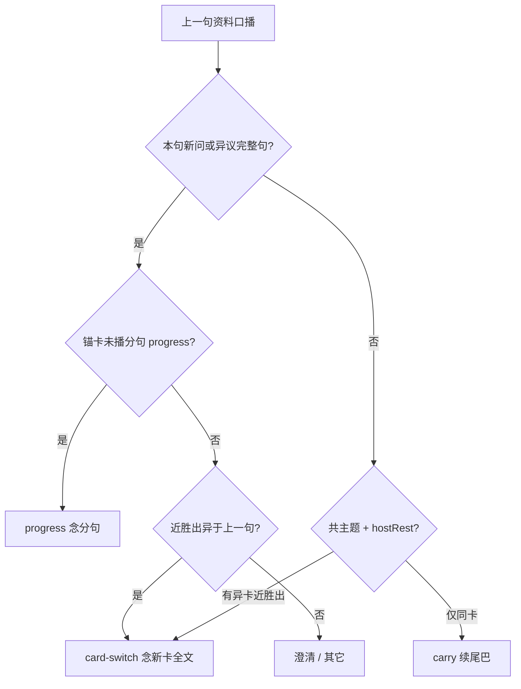

# 换卡后 carry 顶答

## 主张
上一句已是资料口播时，`carry` / `hostRest` 只适合「同卡续说还没念完的后半句」。若本句意图已指向**另一张** FAQ（标题或近胜出可见），再续旧口播尾巴就是卡题分离：日志标题对新卡、听众听到旧卡。

陈述式异议（太贵了、付不起、没信心）往往没有「吗 / 怎么办」，`asksNewQuestion` 若只认疑问骨架，会掉进共主题 carry。

## 取舍
**已修（门控 + schema + 回归）。**

- `decideCore`：即将 `carry` 或完整新问未 `progress` 时，若近胜出口播与上一句明显不同 → `reason=card-switch`（或仍 posterior）念新卡全文。
- `asksNewQuestion`：并入 `objectionComplete`（schema）。
- FAQ 太贵卡标题补无问号陈述体。
- 冒烟：`card-switch-expensive`（收费口播 → 「一年3万九…付不起。」）。

不采用：按「太贵」写引擎业务正则；用豆包临场编保障口径。

## 流程

## 落点
- `desktop/lib/meetingStrategy/agent/relevance.cjs` → `asksNewQuestion` / `cardSwitchAnswer` / carry 前禁令
- `desktop/knowledge/schema/linguistic-operators.json` → `objectionComplete`
- `desktop/knowledge/faq-meeting.txt` → 太贵卡陈述标题
- `desktop/scripts/smoke-scene-faq.cjs` · `desktop/test/cases.jsonl` → `card-switch-expensive`

## 相关
- [[follow-up-interaction]]
- [[selective-abstention]]
- [[bayesian-card-selection]]
