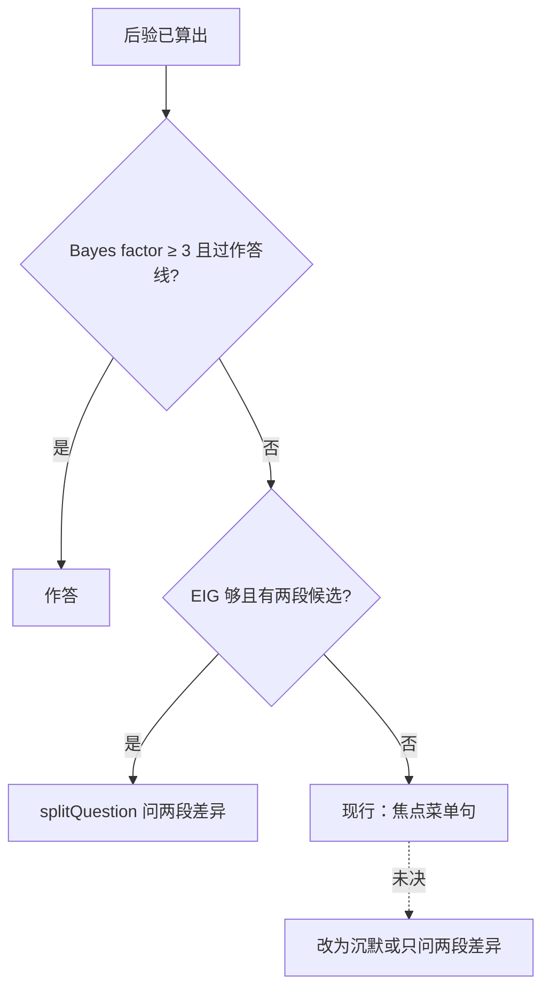

# 澄清问题 vs 菜单套话

## 主张
Aliannejadi 等：主动问一个能澄清意图的问题，检索可大幅提升。Misu 与 Kawahara：语音问句残缺时，按信息增益选确认问题，减少命中项。两者的问题都指向候选差异，不是通用菜单。

## 取舍
**已有**：Bayes factor 不够时，`splitQuestion` 用两张卡的片段。  
**未决**：没有卡达标时，不要用「你想先听哪一步」这种菜单句顶替澄清；应沉默，或只问能分开两个候选的片段。改代码前以现行 `localAsk` / hostReject 行为为准。

## 公式
出处：`relevance.cjs` 的 `eigOf`。\(H\) 是二进制熵（比特）。假设质量来自后验。对候选对 \((a,b)\)，若质量落在 \(a\) 上则 \(P(Y{=}1)=0.85\)，落在 \(b\) 上则 \(0.15\)，其余为 \(0.5\)（`eigHit` / `eigMiss` / `eigOther`）。

\[
\mathrm{EIG}(a,b)=H(Y)-\sum_h p(h)\,H(Y\mid h)
\]

\[
H(p)=-(p\log_2 p+(1-p)\log_2(1-p))
\]

## 流程

## 落点
- `relevance.cjs` → splitQuestion、eig
- `speak-lines.json` → localAsk（现行；未决是否收紧）
- 残句与焦点：`universalOperators.cjs`、`linguistic-operators.json`

## 相关
- [[selective-abstention]]
- [[follow-up-interaction]]
- [[aliannejadi-2019-clarifying-questions]]
- [[misu-2005-speech-ir-clarification]]

## 出处
- [[aliannejadi-2019-clarifying-questions]]
- [[misu-2005-speech-ir-clarification]]
