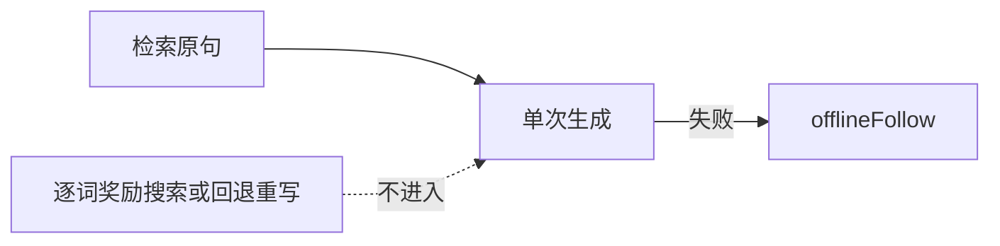

# 逐步解码搜索对齐

## 主张
RAIN、ARGS、Linear Alignment 在生成时改 token 选择或回退。综述把它们标成推理时方法。具体倍数以各篇原文实验表为准，这里不转写未核对的倍数。

## 取舍
**不采用。** 会场半双工 + 豆包超时回退；禁止 n=3 竞标、禁止逐词奖励搜索进口播主路径。

## 流程

## 落点
- 豆包：单次 `stream:true`，温度 0.35
- 失败：`offlineFollow` / kb-fallback，不重开搜索环

## 相关
- [[static-prompt-grounding]]
- [[sample-vs-search-test-time]]
- [[li-2023-rain]]
- [[khanov-2024-args]]

## 出处
- [[iwashima-2025-grounded-responses]]
- [[li-2023-rain]]
- [[khanov-2024-args]]
