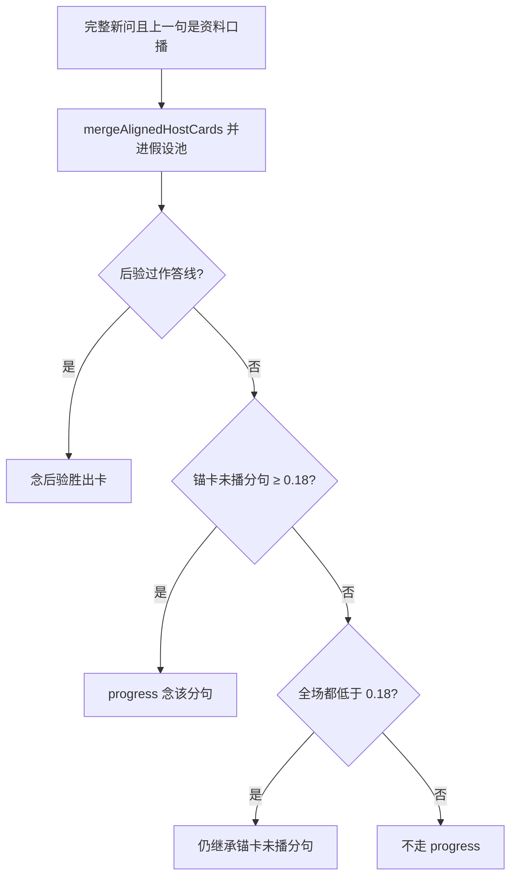

# 追问与未播事实

## 主张
对话 QA 文献强调：追问可能不需新检索，也可能需改写后再检。本仓库用闭题对齐门禁区分「锚卡未播分句」与「零交集短追问」；换卡不走 progress 旁路，并进假设池后走后验。

## 取舍
**已有。** `mergeAlignedHostCards`：对本句已达闭题对齐（≥ 0.18）的卡并进假设池，换卡走 0.42 / 0.28 / Bayes factor ≥ 3。  
`unspokenProgress` 只处理锚卡：  
1. 别的卡已达闭题线且更好 → 返回 null（让后验换卡）；  
2. 锚卡未播分句 ≥ 0.18 → progress；  
3. 全场都低于 0.18 → 仍继承锚卡未播分句（零交集短追问）。  
比较前 `peelMeta`。progress 旁路**不放宽** 0.42 后验。  
无证据时 `offlineFollow` 不拼焦点菜单句（见 [[clarifying-vs-menu]]）。  
确认、拆题、复述是待确认假设，写入 `lastDesign`，不进入 `usableHost`。近义确认（`hypothesisId` 为 probe 或 depth 为 partial）和复述不能被「往下看」提交。有 `pendingAsk` 就按那句重检；上一张已是资料卡则播未播分句，否则念 `pendingMiss`。只有残句才说「后半句没听清」。  
上一张资料卡的标题专名是对话实体，直到用户说出另一个 FAQ 专名。实体槽去掉指代、泛词、弱尾后不足两个字，且本句不是「什么是…」这类自带话题的问句时，检索前只改写一次：有豆包且非 forceRule 时补成一句独立问句，超时或空输出则把实体接到疑问尾。持有实体时不再粘「追问：」或「针对上一答」。句中已有该实体则原文检索。谓语里的对象（如家长）不从泛词表删除。过线答胜出卡；已有资料卡而本句完整疑问仍是澄清或复述时念 `pendingMiss`，并保留上一张答卡。没有上一张答卡的首问无证据仍沉默。同义问法写在 FAQ 标题上。粘滞到期不吞当前完整问。

## 未决
`ability-probe` 已实测：正式后验 0.48 低于「没有证据」0.52，且过窄门挡住，不升格。详见 [[shadow-divergence-catalog]]。

## 流程

## 落点
- `desktop/lib/meetingStrategy/agent/relevance.cjs` → mergeAlignedHostCards、unspokenProgress、offlineFollow
- `run.cjs` / `localAnswer.cjs` 空探针走 offlineFollow

## 相关
- [[query-understanding]]
- [[bayesian-card-selection]]
- [[anantha-2020-cqa-rewrite]]
- [[roy-2024-retrieve-rewrite-respond]]
- [[clarifying-vs-menu]]
- [[selective-abstention]]
- [[elgohary-2019-canard]]
- [[pan-2019-incomplete-utterance-restoration]]
- [[adlakha-2022-topiocqa]]

## 出处
- [[yue-2025-llm-agent-qa]]
- [[roy-2024-retrieve-rewrite-respond]]
- [[aliannejadi-2019-clarifying-questions]]
- [[elgohary-2019-canard]]
- [[su-2019-utterance-rewriter]]
- [[pan-2019-incomplete-utterance-restoration]]
- [[adlakha-2022-topiocqa]]
- [[kongyoung-2023-followup-rewrite]]
- [[guo-2024-cat-iur]]
- [[mo-2024-chiq]]
