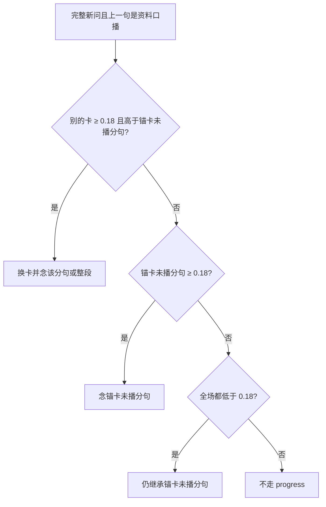

# 追问与未播事实

## 主张
对话 QA 文献强调：追问可能不需新检索，也可能需改写后再检。本仓库用闭题对齐门禁在「换卡 / 念未播分句 / 继承锚卡」三档之间选。

## 取舍
**已有（旁路）。** `unspokenProgress`：  
1. 别的卡标题或分句 ≥ 0.18 且更好 → 换卡；  
2. 锚卡未播分句 ≥ 0.18 → progress；  
3. 全场 < 0.18 → 继承锚卡（零交集短追问）。  
比较前 `peelMeta`。这是旁路，**不放宽** 0.42 后验。

## 未决
把「另一张卡已经对上本句」收回后验比较，使换卡仍走 0.42 / 0.28 / Bayes factor ≥ 3。`progress` 只留全场都低于 0.18 的零交集短追问。未改代码之前，现行行为以上面三档为准。

## 流程

上图是现行旁路。未决改动是把「换卡」从第一支挪回后验比较，图中尚未改。

## 落点
- `desktop/lib/meetingStrategy/agent/relevance.cjs` → unspokenProgress、offlineFollow
- `run.cjs` / `localAnswer.cjs` 空探针走 offlineFollow

## 相关
- [[query-understanding]]
- [[bayesian-card-selection]]
- [[anantha-2020-cqa-rewrite]]
- [[roy-2024-retrieve-rewrite-respond]]
- [[clarifying-vs-menu]]

## 出处
- [[yue-2025-llm-agent-qa]]
- [[roy-2024-retrieve-rewrite-respond]]
- [[aliannejadi-2019-clarifying-questions]]
