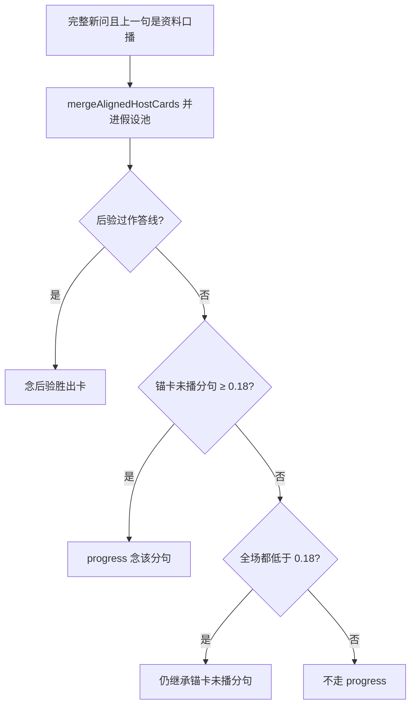

# 追问与未播事实

## 主张
对话 QA 文献强调：追问可能不需新检索，也可能需改写后再检。本仓库用闭题对齐门禁区分「锚卡未播分句」与「零交集短追问」；换卡不走 progress 旁路，并进假设池后走后验。

## 取舍
**已有。** `mergeAlignedHostCards`：对本句已达闭题对齐（≥ 0.18）的卡并进假设池，换卡走 0.42 / 0.28 / Bayes factor ≥ 3。  
`unspokenProgress` 只处理锚卡：  
1. 别的卡已达闭题线且更好 → 返回 null（让后验换卡）；  
2. 锚卡未播分句 ≥ 0.18 → progress；  
3. 全场都低于 0.18 → 仍继承锚卡未播分句（零交集短追问）。  
比较前 `peelMeta`。progress 旁路**不放宽** 0.42 后验。  
无证据时 `offlineFollow` 不拼焦点菜单句（见 [[clarifying-vs-menu]]）。

## 未决
编译影子已能点名「老师不具备做阅读测评…」等卡，正式路径仍可能 `no_evidence` 空答。影子升格正式（置信度门、对齐权重）见第 4、5 项，当前只打影子对比。

## 流程

## 落点
- `desktop/lib/meetingStrategy/agent/relevance.cjs` → mergeAlignedHostCards、unspokenProgress、offlineFollow
- `run.cjs` / `localAnswer.cjs` 空探针走 offlineFollow

## 相关
- [[query-understanding]]
- [[bayesian-card-selection]]
- [[anantha-2020-cqa-rewrite]]
- [[roy-2024-retrieve-rewrite-respond]]
- [[clarifying-vs-menu]]

## 出处
- [[yue-2025-llm-agent-qa]]
- [[roy-2024-retrieve-rewrite-respond]]
- [[aliannejadi-2019-clarifying-questions]]
