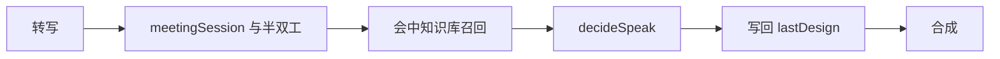

# Agent QA 流水线对照

## 主张
综述中的规划→问句理解→检索→作答→追问，可映射到本仓库固定流水线，而不是多 Agent 编排。

## 取舍
**已有同构，不扩成多专家。**

| 综述块 | 本仓库 |
| --- | --- |
| 规划 | 责任链（回声→…→咨询→静默）+ 半双工 PHASE |
| 问句理解 | focus / peelMeta / 问法别名 |
| 检索 | FAQ corpus / wiki（会中库） |
| 作答 | decideSpeak 后验选卡 + compose |
| 追问 | unspokenProgress / offlineFollow |

## 流程

责任链在进入咨询之前：回声、停止、会议起止、占麦、唤醒、总结。静默、占麦、播报中的非放行输入不到检索。开发 wiki 不在这条链上。

## 落点
- `desktop/.cursorrules` 单向流水线
- `decideSpeak.cjs` → `relevance.cjs` / `run.cjs`

## 相关
- [[query-understanding]]
- [[retrieval-rerank-critique]]
- [[follow-up-interaction]]
- [[bayesian-card-selection]]
- [[yue-2025-llm-agent-qa]]

## 出处
- [[yue-2025-llm-agent-qa]]
