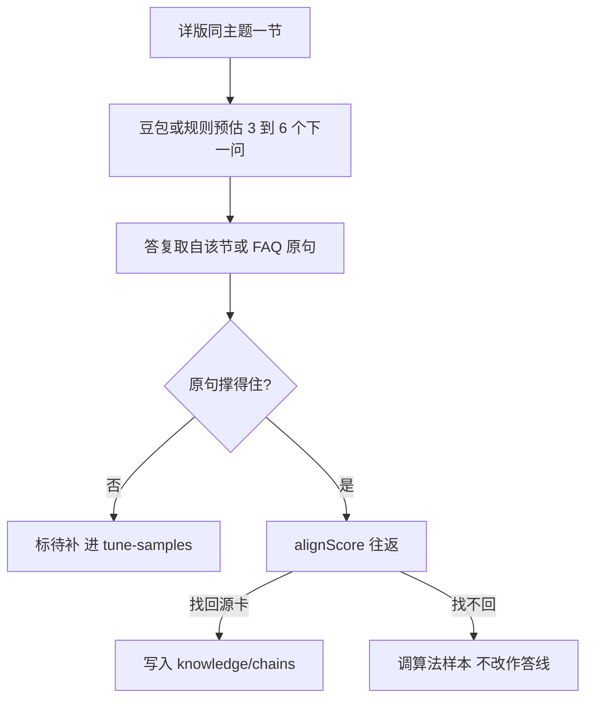

# 离线预估下一问

## 主张
Doc2Query 把「这段资料会被问哪些问题」放在索引阶段完成。Dialog Inpainting 把资料原句当作已经说出口的答复，只补两句之间读者会问的那一句。Promptagator 只保留能被检索找回源段落的合成问句。Rosset 等要求下一问有用：往下一步走，而不是重复刚答过的定义。QuAC 的老师只能用文中短段作答，答不出就标不能答。doc2dial 按文档里的条件与做法排对话流。Evol-Instruct 的加深、具体化、增加步骤用来把一问做成 3～6 步；其另起新题的变异不取。

## 取舍
**已有（离线 + 会中最小接线）。** 会前跑 `npm run knowledge:distill`，产物在 `desktop/knowledge/chains/`。会中不改 FAQ。

采用：详版一节的原句是答复；豆包（有密钥时）预估问句，并把原句收成不超过 80 字的口播。无密钥或 `--force-rule` 时按分句规则扩链。一条链 3～6 步。预估问句送进现有 `alignScore`：找得回源卡或详版则写入 `by-card/`；找不回则记入 `tune-samples.jsonl`。预备答复要对上种子口播或详版摘录。

会中：上一张是资料答卡且本句完整疑问时，若 `decideSpeak` 未定卡，则用 `matchChainStep` 对齐链上问句。须同时过步对齐与去掉加深尾巴后的核心对齐；仅共享「怎么做」一类尾巴不够。本句已指向别的 FAQ（`formalWinnerId`）或种子对齐已换题时，改跟新卡链，不沿用旧链。命中则念预备答复。对不上仍走澄清 / `pendingMiss`。作答线不改。

已有：省略句改写、卡片对齐、未播分句继承、追问线索、影子马尔可夫。这些不生成下一句原文。正式马尔可夫保持全 1。作答线不改：后验 ≥ 0.42，对齐 ≥ 0.28，闭题 ≥ 0.18，Bayes factor ≥ 3。

不采用：训练 Doc2Query / T5、微调豆包、In-breadth 另起话题、会中当场编口径、把本页句子写入 `faq-meeting.txt`。

## 流程

现行省略追问仍见 [[follow-up-interaction]]。

## 落点
- `desktop/lib/knowledge/chains/` → distill / generate / roundtrip / write / match
- `desktop/lib/meetingStrategy/paths/consult/localAnswer.cjs` → 资料卡后 `matchChainStep`
- `desktop/scripts/distill-chains.cjs` · `desktop/scripts/smoke-chain-follow.cjs`
- `desktop/knowledge/schema/distill-chains.json`
- `desktop/knowledge/chains/` 产物
- 不改 `engine-hyperparams.json` 的 `markov` 与四条作答线

## 相关
- [[follow-up-interaction]]
- [[query-understanding]]
- [[atomic-support-eval]]
- [[selective-abstention]]
- [[markov-smoothing]]

## 出处
- [[nogueira-2019-doc2query]]
- [[dai-2022-dialog-inpainting]]
- [[dai-2022-promptagator]]
- [[bonifacio-2022-inpars]]
- [[rosset-2020-question-suggestion]]
- [[choi-2018-quac]]
- [[feng-2020-doc2dial]]
- [[xu-2023-evol-instruct]]
- [[gao-2022-cir]]
