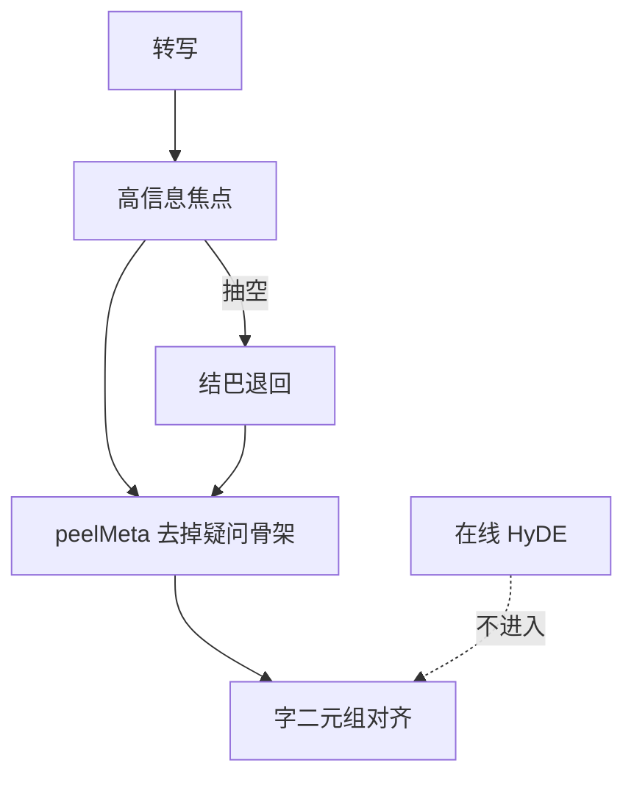

# 问句理解

## 主张
Agent QA 综述把槽位、焦点、改写、HyDE 放在检索之前。会场转写短、常省略主语。

## 取舍
- **已有**：高信息焦点片段、疑问骨架 `peelMeta`、FAQ 标题问法别名。实体槽只有指代或泛词时，豆包只把本轮补成一句独立问句；超时回退为实体接疑问尾。改写句仍进 `decideSpeak`。见 [[follow-up-interaction]]。
- **不采用**训练 CANARD / Utterance ReWriter / T5 / CHIQ，也不用改写结果直接口播。
- **不采用在线 HyDE**（每问 Embedding），也不采用 CHIQ 的假想回答。
- 结巴只在焦点抽空时退回，不进检索对齐主路径。

## 流程

## 落点
- `universalOperators.cjs` → extractHighEntropyFocus
- `linguistic-operators.json` → interrogative / dropWords
- `relevance.cjs` → peelMeta、asksNewQuestion

## 相关
- [[follow-up-interaction]]
- [[gao-2022-hyde]]
- [[anantha-2020-cqa-rewrite]]
- [[elgohary-2019-canard]]
- [[pan-2019-incomplete-utterance-restoration]]
- [[misu-2005-speech-ir-clarification]]
- [[clarifying-vs-menu]]
- [[yue-2025-llm-agent-qa]]

## 出处
- [[yue-2025-llm-agent-qa]]
- [[anantha-2020-cqa-rewrite]]
- [[elgohary-2019-canard]]
- [[su-2019-utterance-rewriter]]
- [[pan-2019-incomplete-utterance-restoration]]
- [[gao-2022-hyde]]
- [[misu-2005-speech-ir-clarification]]
