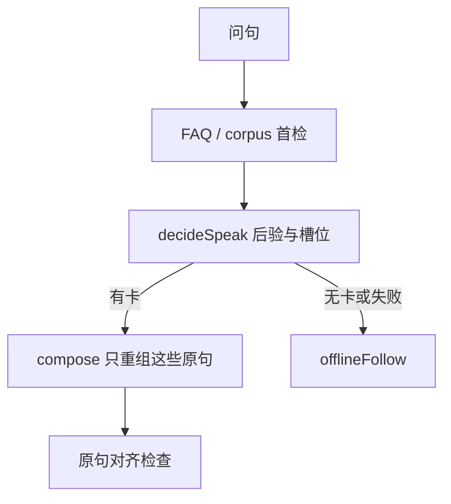

# 检索后核对与自批判

## 主张
Self-RAG：检索后批判段落是否支撑生成。思想有用；完整训练栈过重。

## 取舍
**部分对齐。**  
- 首检：FAQ / corpus，不用 LLM 当首检。  
- 批判：槽位门、原句对齐、`offlineFollow` 在别的卡达标时禁止 hostRest/localAsk。  
- **不采用** Self-RAG 微调与特殊批判 token。

## 流程

LLM 不在首检之前。批判不另训一个带特殊 token 的模型。

## 落点
- `relevance.cjs` / `run.cjs` slot-critic、knowledgeSpeakLine
- compose 只重组检索原句

## 相关
- [[asai-2023-self-rag]]
- [[roy-2024-retrieve-rewrite-respond]]
- [[atomic-support-eval]]
- [[static-prompt-grounding]]

## 出处
- [[asai-2023-self-rag]]
- [[yue-2025-llm-agent-qa]]
