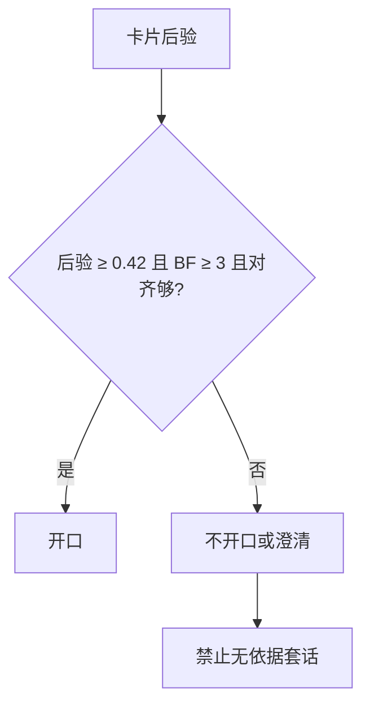

# 选择性拒答

## 主张
Kamath、Jia、Liang：在域外混合测试上，只靠模型最大概率会过度自信。系统要在尽量多答的同时保持准确，就必须会拒答。他们的校准器是额外分类器；文中在 80% 准确率下答到 56% 的题。

## 取舍
**已有。** 无证据、后验不足、Bayes factor 不足 → 不开口或澄清，禁止无依据套话。  
**不采用**训练文中的校准器，也不放宽 0.42 / 0.28 / BF≥3。

**已有。** 已有资料答卡之后，完整疑问若仍是澄清、复述或无证据，念 `pendingMiss`。没有上一张答卡的首问无证据仍沉默。见 [[follow-up-interaction]]。

## 流程

## 落点
- `relevance.cjs` decideCore 的 no_evidence / ambiguous
- `.cursorrules`：禁止再念无依据套话

## 相关
- [[bayesian-card-selection]]
- [[clarifying-vs-menu]]
- [[kamath-2020-selective-qa]]

## 出处
- [[kamath-2020-selective-qa]]
