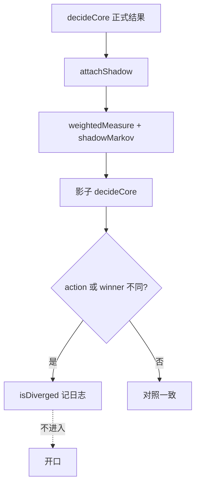

# 影子分歧目录

## 主张
正式开口用字二元组对齐；影子用 IDF / 极性重算同一批候选。评测全绿前不得用影子替换作答线。先把分歧读完，再决定要不要扶正。

## 取舍
**已有（只打影子）。** `attachShadow` 冻结正式结果后，用 `weightedMeasure` + `shadowMarkov`（现为全 1）再跑一遍 `decideCore`。`isDiverged` 只写日志与 benchmark 诊断。  
**不扶正**：下列四条扶正都会伤评测或产品语义。`ability-probe` 已按正式数字关闭。

## 现行四条（benchmark `shadow diverged 4/52`）

| id | 正式 | 影子 | 读法 |
| --- | --- | --- | --- |
| `how-do` / `scene-how-do-short` | clarify → 落地准备卡 | clarify → 成果展卡 | 同是 ambiguous；「如何做」过短，IDF 把「做」抬向成果展。扶正会换澄清对象，冒烟已接受正式拆问。 |
| `ability-probe` | clarify / `no_evidence` 空答 | answer → 老师不具备做阅读测评… | **不升格。** 卡已在池内：正式后验 0.48、对齐 0.63、窄度 0.64；「没有证据」0.52，未满足 `p > p0`。窄度 ≥ 0.55 且对齐 < 0.72，过窄门也会挡住。IDF 对齐 0.88、窄度仍 0.62，只是跨过 0.72 才开口。问句没有「阅读测评」，正式拒答成立。 |
| `report-appeal-short` | progress → AI 测评卡 | clarify → 收益保障卡 | 「有没有吸引力？」零交集短追问。影子被「有没有」拽到收益保障。**禁止**用高 IDF 新实词区分跨题 vs 短追问。 |

## 流程

## 落点
- `relevance.cjs` → attachShadow、weightedMeasure、shadowPriorScale
- `engine-hyperparams.json` → `shadowMarkov`（全 1 占位）
- `tools/estimateMarkovFromLogs.cjs` → 样本够才打印非 1 矩阵，不自动写入
- `test/benchmarkRunner.cjs` → `div=` / `shadow ids`

## 相关
- [[char-bigram-alignment]]
- [[markov-smoothing]]
- [[follow-up-interaction]]
- [[bayesian-card-selection]]
- [[selective-abstention]]

## 出处
- `.cursorrules` 第 2 节 C
- [[kondrak-2005-ngram-similarity]]
- [[zhai-2001-lm-smoothing-ir]]
